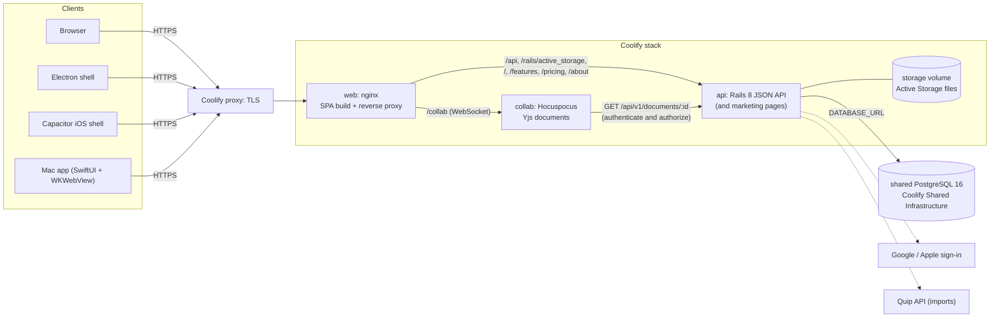
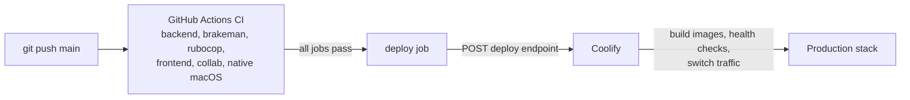

# Architecture

How Inertia's pieces fit together. [services.md](services.md) lists every service and setting, [deployment.md](deployment.md) is the production runbook, and [features/](features/README.md) documents each feature.

## Production

One Coolify Docker Compose stack (`docker-compose.coolify.yml`); only `web` is public.

- **web** (`frontend/`): nginx serves the webpack build and decides which paths go to Rails (`frontend/nginx/default.conf`). A new Rails-rendered page or API prefix needs a location there.
- **api** (`backend/`): controllers (HTTP), services (`app/services`), models (queries and rules) and Blueprinter serializers (`app/blueprints`). Runs `db:prepare` on every boot, so migrations deploy with the code. Authenticates with Devise and JWT; every request is scoped to a Space by the `X-Workspace-Id` header (see [spaces.md](spaces.md)).
- **collab** (`collab-server/`): holds no secrets and stores no Yjs state. It asks Rails whether a person may open a document, seeds the in-memory Yjs document from `documents.content`, and PATCHes the content back to Rails when edits settle, so Rails stays the source of truth.
- **Mac app** (`macos/`): native sign-in and local `.inertia-tasks` files (see [task-file-format.md](task-file-format.md)); the workspace itself is the same React app in a WKWebView.

## Delivery

Pushing `main` is the only way to deploy; Coolify's Auto Deploy is off.

## Local development

`docker-compose.yml` runs `backend` (port 3847), `frontend` (5174), `collab` (1234), PostgreSQL and Redis; the frontend calls the API directly at `API_URL`. `make dev-all` adds the native Mac app; `make dev-live` points the API at the live database (read [README.md](README.md#against-the-live-database) first).

## Where code lives

| Concern | Backend | Frontend |
| --- | --- | --- |
| Persistence and rules | `app/models/` | n/a |
| Business workflows | `app/services/` | n/a |
| HTTP | `app/controllers/api/v1/` | n/a |
| JSON shape | `app/blueprints/` | `src/types/` |
| Calling the API | n/a | `src/lib/api.ts` (client), `src/api/` (one class per model) |
| Pure logic per entity | n/a | `src/data/` |
| Pages | n/a | `src/view/<name>/` |
| Shared UI | n/a | `src/components/ui/` (primitives), `src/components/` |
| Styles | n/a | `src/styles/` (app-wide), one `.scss` beside each component or view |
